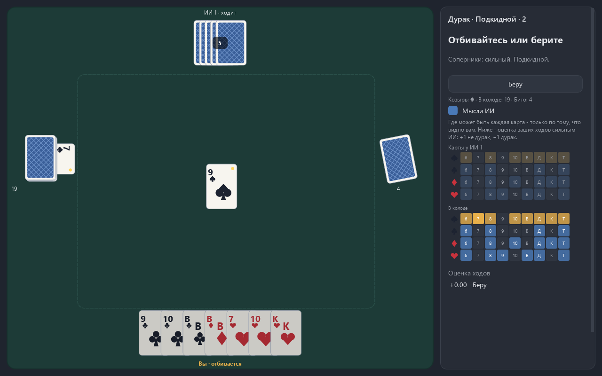
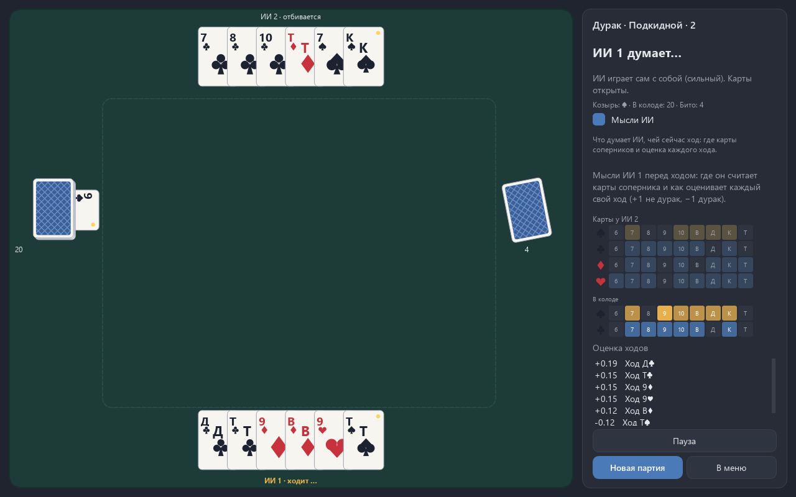
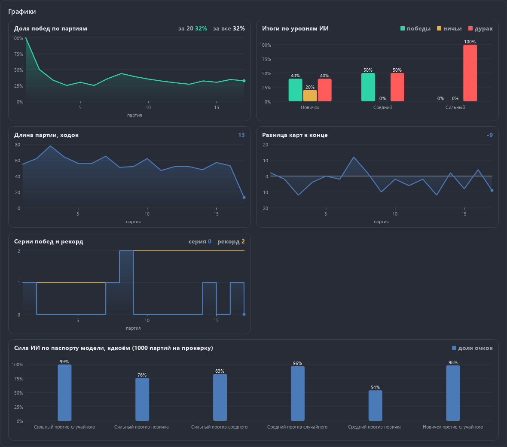

<div align="center">

# Дурак против ИИ

**Подкидной и переводной дурак на 2-4 игроков. ИИ не видит ваших карт: его код получает только то, что видно игроку за столом, и это проверяет закон-тест.**

[English version of this file](README.md)

[](LICENSE)



</div>

В крестиках-ноликах и шашках ИИ видит всю доску. В дураке нет: карты соперника закрыты, и
честный ИИ должен угадывать их по ходу партии, как человек. Подглядеть было бы проще всего,
поэтому главное правило проекта - ИИ получает только `observation(state, player)`: свою
руку и публичное (стол, отбой, козырь, размер колоды, сколько карт у каждого, кто что
забирал). Остальное до его кода не доходит.

## Что умеет

- **Подкидной** по умолчанию и **переводной** переключателем. Колода 36 карт.
- **От 2 до 4 игроков**. Человек всегда один, остальные - ИИ.
- Три уровня ИИ: **новичок**, **средний**, **сильный**. И режим **«ИИ против ИИ»** с открытыми картами - для показа.
- **«Мысли ИИ»** (галочка справа на столе): сетка 4 × 9 на каждого соперника и на колоду - где может лежать каждая карта, и оценка каждого хода. В игре против ИИ это ваш учёт карт и оценка ваших ходов сильным ИИ; на ходу ИИ его мысли скрыты, сетка обновляется по вашему наблюдению. В показе «ИИ против ИИ» - мысли того ИИ, чей ход; у новичка вместо оценок строка «играет по правилам» и ход, который выбирают правила. Над сеткой всегда написано, чей ход и чьи это мысли.


- **Статистика с графиками**: доля побед по партиям (скользящее среднее за 20 партий и за
  все), итоги против каждого уровня ИИ, длина партии в ходах, разница карт в конце (плюс -
  сколько осталось у дурака, когда вы вышли, минус - сколько у вас), серии побед с рекордом
  и сила ИИ по паспорту. Графики - из общего `aikit.charts` (QPainter, без matplotlib), в две
  колонки, в узком окне в одну; пока данных нет, на карточке написано, откуда
  они возьмутся. Партии для графиков пишутся в `games.json` рядом со статистикой, только
  те, что идут в статистику (без подглядывания и не показ).
- **Как считаются партии**: партия считается с вашего первого хода (автоматический пас, когда
  подкинуть нечего, - не ваш ход). Брошенная после него - новая партия, меню, закрытие окна -
  засчитывается как «дурак»; если вы уже вышли, а ИИ доигрывают, - «не дурак» (разница карт
  тогда - самая большая рука среди доигрывающих). Вышли, пока другие играют, - «не дурак» при
  любом их конце, даже если последние двое вышли одновременно. То же написано на странице
  статистики.



- Карты нарисованы своим кодом (масти - фигуры из кругов и многоугольников), чужих колод нет.
- У стопок на столе подписи «Колода N» и «Бито N». Имя и роль каждого игрока («ходит», «отбивается», «вышел», «дурак», «…» - думает) никогда не закрыты картами: у боковых соперников подпись над веером, сверху и снизу - своя строка у края. Закон-тест проверяет это на 9 размерах стола (до экрана 4K), вдвоём-вчетвером, с рукой до 30 карт.
- Темы Paint (тёмная и светлая), сукно стола в цвет темы. Русский и английский. Окно открывается там, где его закрыли.

## Почему ИИ честный и как это проверено

Закон-тест `tests/test_honesty.py`: берётся случайная позиция, все неизвестные игроку карты -
неизвестная часть рук соперников и закрытая колода - перемешиваются и раскладываются заново
(размеры рук те же). После этого:

1. наблюдение игрока должно совпасть до бита;
2. каждый уровень ИИ с тем же зерном должен выбрать тот же ход.

Известные всем карты при этом остаются на месте: взятые со стола и открытый козырь у того,
кто его добрал, видел каждый. Тест написан раньше кода наблюдения. Пять мутантов, которые
ломают честность нарочно (показать чужие руки, порядок колоды, чужие допустимые ходы,
забыть взятые карты, не вычеркнуть сыгранную известную карту), все ловятся.

Честность доведена и до окна:

- «Мысли ИИ» в игре против ИИ считаются только из **вашего** наблюдения. Если бы сетка
  показывала, что думает ИИ, по нулям в ней читалась бы его собственная рука.
- Закрытые карты соперника не имеют своих мест в веере: все рубашки летят из центра. Иначе
  по тому, из какого места веера вылетела карта, угадывался бы порядок чужой руки.
- Пас «нечем подкинуть» и пас «не хочу» выглядят одинаково: игрок без подходящей карты
  всё равно получает очередь, и его единственный ход - пас.

## Как играет ИИ

1. **Учёт карт** (`game/ai/tracker.py`). Для каждой невидимой карты - вероятность быть у
   каждого соперника и в колоде. Строки дают сумму 1, столбцы - ровно число карт в каждом
   месте; пропорции подгоняются чередованием нормировок строк и столбцов (Синкхорн).
   Вывод из «не отбился»: защитник взял, когда на столе лежала карта, - вес карт, которыми
   её можно побить, у него падает до 0,15. Это не запрет: взять можно и нарочно. После
   добора подозрение слабеет в той доле, в какой обновилась рука.
2. **Раскладки** (детерминизация, PIMC). Невидимые карты раскладываются по рукам и колоде
   много раз - по вероятностям учёта, без противоречий известному.
3. **Поиск в каждой раскладке.** Каждый свой ход делается, отбой доигрывается простыми
   правилами за всех, позиция на границе отбоя оценивается. Выбирается ход с лучшей средней
   оценкой.
4. **Сеть на numpy** оценивает позицию на границе отбоя, чтобы не доигрывать каждую партию
   до конца: 164 входа (масти повёрнуты так, что козырь всегда на одном месте), слои
   256 и 128, выход tanh: +1 «не дурак», −1 «дурак». 75 265 весов.
5. **Точный перебор в конце.** Колода пуста и в игре двое - неизвестного не осталось: все
   невидимые карты у соперника. Тогда партия просчитывается до конца минимаксом с
   запоминанием.

| Уровень | Как играет |
|---|---|
| Новичок | правила: ходить младшей, отбиваться младшей подходящей, беречь козыри, не тратить карты, если всё равно не отбиться |
| Средний | учёт карт и 8 раскладок, оценка формулой (меньше карт и сильнее карты - лучше) |
| Сильный | учёт карт, 24 раскладки, оценка сетью, точный перебор вдвоём при пустой колоде |

В окне у среднего и сильного есть ещё ограничение времени на ход (1 и 1,5 с), а поиск
останавливается флагом, если партию закрыли.

## Паспорт модели

1000 партий на каждую проверку, файл `game/models/durak-value.json`. Вдвоём - доля очков
(победа 1, ничья 1/2) на парах раздач: та же колода дважды с обменом мест, чтобы удача
раздачи гасилась. Втроём и вчетвером - как часто ИИ остаётся дураком; при равной игре это
1/3 и 1/4. Тесты пересчитывают первые партии каждой проверки с теми же зёрнами - партия
в партию.

| Уровень | Против случайного | Против новичка | Против среднего | Втроём (дурак) | Вчетвером (дурак) |
|---|---|---|---|---|---|
| Сильный | 99,5% | 75,7% | 82,6% | 12,1% | 7,6% |
| Средний | 96,5% | 53,7% | - | 23,2% | 16,6% |
| Новичок | 97,9% | - | - | 0,2% | 0,1% |

Втроём и вчетвером соперники сильного и среднего - новички, соперники новичка - случайные
игроки.

## Обучение

`python -m game.train` - только по команде. Работники - отдельные процессы, по одному
потоку BLAS у каждого, их 4: ПК делят и другие задачи. После каждого круга - строка в
`train.log` и снимок `snapshot.npz` с весами и состоянием Adam; `--resume` продолжает с
места, `--trial` делает пробный круг и оценивает время всего обучения.

Итог: 20 кругов по 30 000 партий - 600 000 партий, 20,7 млн позиций, **34 минуты** на 4
процессах. Пробный круг оценил 30 кругов в 0,74 часа; доля очков сильного против новичка в
промежуточных проверках встала на 0,70-0,72 (8 раскладок) уже к 5-му кругу и дальше не
росла, поэтому обучение остановлено на 20-м круге.

**Чему учится сеть - и что не сработало.** Первая версия училась в игре с собой: каждый
игрок смотрел на отбой вперёд с текущей сетью и видел все карты. Поиск с такой сетью
набрал против новичка 55% после 12 кругов, а дообучение той же схемой с хорошей сети даже
ухудшило результат: с 77% до 63-66%. Причина - несогласованность: поиск доигрывает отбой
простыми правилами, и оценка в конце отбоя должна знать цену позиции именно при такой
игре, а сеть училась цене при игре «зрячих» игроков. Когда целью стал исход партий,
сыгранных простыми правилами (с 10% случайных ходов для разнообразия), поиск с сетью сразу
дал 75-77% против новичка. Так сеть и обучена.

## Правила в коде

Правила и порядок хода - обычный код (`game/core/durak.py`), ИИ их не знает. Каждое правило
spec §2 проверено вручную собранной раздачей:

- раздача по 6, последняя карта открыта и задаёт козырь; первым ходит младший козырь
  (со второй партии подряд - по настройке, младший козырь или следующий за дураком);
- отбиться - старшей той же масти или козырем; козырь - только старшим козырем;
- подкидывают все, кроме отбивающегося, по очереди с ходившего, только достоинства со стола;
  новая карта даёт всем новый круг;
- два упрощения против игры за живым столом: карты кладутся по одной, а подкинуть можно,
  только когда всё на столе побито или защитник сказал «беру» - пока он отбивается,
  подкидывать нельзя;
- на столе не больше 6 карт (переключатель «первый отбой - 5») и не больше не побитых, чем
  карт у защитника;
- «беру»: подкинуть ещё можно, ход переходит к следующему за взявшим;
- добор до 6: ходивший, подкидывавшие, защитник последним; открытый козырь уходит последним;
- вышел - кто без карт при пустой колоде; последний с картами - дурак; ничья, если
  последние двое вышли одновременно;
- переводной: картой того же достоинства, пока ни одна карта не побита и у следующего
  хватает карт.

Найдено по ходу: в переводном вдвоём позиция может повторяться (взял - перевёл обратно -
взял), и точный перебор уходил в бесконечную рекурсию. Теперь повтор позиции на пути
перебора считается ничьей.

## Что нашла проверка перед 1.0.0

Перед выпуском код читал второй агент, а оболочка ИИ-Игротеки впервые держала игру во
вкладке рядом с другими. Найдено и исправлено, на каждый случай есть тест и мутант:

| Что было в 0.9.0 | Чем грозило | Что стало |
|---|---|---|
| Окно игры звало `gc.freeze()` | Сборщик мусора общий на процесс: во вкладке оболочки все её объекты на тот момент (около 625 тысяч в замере) уходили в постоянное поколение и больше никогда не освобождались, даже став мусором | Вызова нет; закон-тест: создание окна и партия не меняют ни число замороженных объектов, ни включённость и пороги сборщика, а в `game/` и `aikit/` нет ни одного `gc.freeze`, `disable`, `set_threshold` |
| Каждый запрос к ИИ - свой QThread, дочерний объект окна | Потоки не удалялись до закрытия окна вместе с агентом и наблюдением: 51, 92, 136 объектов после трёх партий вдвоём | Поток без родителя, его убирает из списка сам сигнал `finished`; после партии живых объектов потоков - не больше одного |
| Окно разрушалось вместе с потоками ИИ | Если `shutdown()` не успевал за 2 с (машина перегружена), разрушение окна с работающим QThread - это qFatal и падение всей программы. В 0.9.0 это прятал `gc.freeze`: старые окна не разрушались никогда. Без него проверки на Gitea один раз упали с Aborted посреди сборки мусора | Не успевшие потоки уходят в «сироты», доживают до флага остановки и только потом удаляются; тест: поток, глухой к флагу, переживает разрушение своего окна |
| Кнопки «Играть» и «Новая партия» передавали `clicked(False)` как зерно | Каждая партия с кнопки шла с одной раздачей (зерно 0); клавиша N работала верно, поэтому тесты не видели | Кнопки зовут `start_game` без аргументов |
| Пробел и T работали на любой странице | Из меню, статистики или настроек они ходили «Бито» или «Беру» за человека в спрятанной партии, и та доигрывалась в фоне с записью в статистику | Ход человека принимается только со стола |
| Точный перебор в конце не смотрел ни флаг остановки, ни срок хода | Сильный ИИ думал до 2,8 с при пределе 1,5 с, закрытие окна могло не уложиться в 2 с по контракту | Флаг и срок проверяются каждые 64 узла, перебор уступает обычному поиску |
| Раздача не анимировалась (spec §5) | Карты появлялись в руках сразу | Карты летят из колоды по очереди; первый ход ИИ ждёт, пока долетит последняя |
| Панель «Мыслей ИИ» в показе «ИИ против ИИ» пустая (нашла ручная проверка) | Ход ИИ приходил раньше мыслей, и те выбрасывались как устаревшие: в замере 17 ответов из 17 у новичка, 16 из 16 у среднего; у сильного 14 доходили, но тут же стирались ходом - сетка видна 0% времени. В игре против ИИ на его ходу панель тоже пустела | В показе сначала мысли, потом ход; на ходу ИИ в игре обновляется ваш учёт карт; прошлые мысли не стираются, пока не придут новые; над сеткой - строка, чей ход и чьи мысли, у новичка - «играет по правилам». Тест: галочка включена - во всех режимах и на всех уровнях панель не пустая |
| `tests/test_privacy.py` запрещал адрес origin | В клоне с GitHub origin - `github.com`, а он законно есть в скрипте выкладки: проверка покраснела бы на CI GitHub | Публичные адреса (github.com и подобные) не считаются личными |

**Пауза во вкладке.** Оболочка зовёт `pause()`, когда вкладку прячут, и `resume()`, когда
показывают. Теперь у игры они свои: ИИ перестаёт думать и ходить, таймеры стоят, полёт
карт сразу кончается; после возврата партия идёт с того же места. Без них оболочка гасила
только таймеры, а ответ ИИ, пришедший из потока, всё равно делал ход в спрятанной вкладке.

**Почему `gc.freeze()` не нужен.** Его добавили по опыту ChessCheckersAi: полный проход
сборщика держит GIL, и окно замирает посреди поиска. Замер `tools/gc_bench.py`: сильный ИИ
без предела времени выбирает ход в 600 одних и тех же позициях, считается процессорное
время потока (на машине шли и другие задачи, часы врут).

| В памяти | Поиск, с ЦП на 600 ходов | Полные проходы сборщика за поиск |
|---|---|---|
| только игра, с `gc.freeze` | 14,7 | 4, всего 31 мс |
| только игра, без него | 14,9 | 4, всего 94 мс |
| игра и 300 тысяч объектов «оболочки», с `gc.freeze` | 15,3 / 15,2 / 15,3 | 4, всего 31-47 мс |
| то же без него | 14,7 / 15,2 / 15,2 | 1, на 94-125 мс |

Скорость поиска одна и та же, разница в пределах разброса между прогонами. Без заморозки
окно может замереть примерно на 0,1 с раз в 15 секунд чистого счёта ИИ, и то в большой
оболочке; сама игра держит около 35 тысяч объектов, и полный проход у неё короче 16 мс,
шага таймера Windows. Заморозка же стоила оболочке памяти навсегда.

## Чего нет

- **Время ответа ИИ не выровнено.** Единственный возможный ход (пас, когда подкинуть
  нечего) ИИ делает сразу после паузы из настроек, а ход с выбором - после поиска. Обычно
  разница мала: у сильного половина ходов считается за 0,02 с, 90% - быстрее 0,12 с. Но
  1% ходов он думает дольше 1,3 с, и внимательный игрок поймёт, что выбор у него был.
- Порядок добора после перевода идёт от того, кто перевёл, а не от первого ходившего.
  Правила за столом тут расходятся; на исход влияет только втроём-вчетвером в переводном,
  когда колода почти кончилась.

## Проверки

328 проверок (pytest), окно - только без экрана (Qt offscreen), мышь - собранными событиями,
настоящий курсор не трогается; ожидания ИИ - с тайм-аутом.

- Ручные раздачи на каждое правило и законы на случайных партиях (hypothesis, 400 примеров):
  все 36 карт всегда на месте, защита бьёт атаку, партия кончается, дурак один или ничья.
- Закон честности, законы учёта (суммы строк 1, невозможные карты 0, настоящее место
  карты всегда возможно), раскладки не противоречат наблюдению.
- Мутационная проверка `tools/mutate.py`: 104 нарочные поломки правил, честности, учёта,
  поиска, сети, обучения, окна и раскладки стола (с 1.0.0 - и жизни во вкладке: сборщик, пауза, потоки,
  раздача) - все пойманы.
- Самопроверка `python main.py --selftest итог.txt`: правила, сеть, две партии через окно.

## Запуск и сборка

```
uv venv --python 3.13 .venv
uv pip install -r requirements-dev.txt
.venv\Scripts\python main.py
.venv\Scripts\python -m pytest -q
```

`python build.py` (нужны pyinstaller и pillow) собирает папку `dist/DurakAi`, portable-архив
и установщик NSIS по-русски. Portable-версия держит настройки в папке `saves` рядом с exe.

Только PySide6 и numpy, без pygame и PyTorch. Игра устроена по контракту ИИ-Игротеки:
`game/` - всё своё, `aikit/` - общий набор (темы, настройки, статистика, слои сети).

Лицензия MIT.
